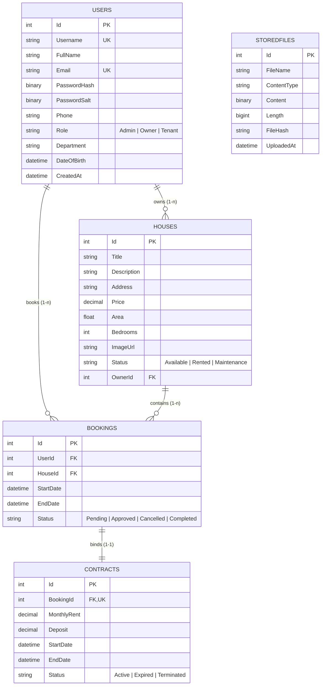
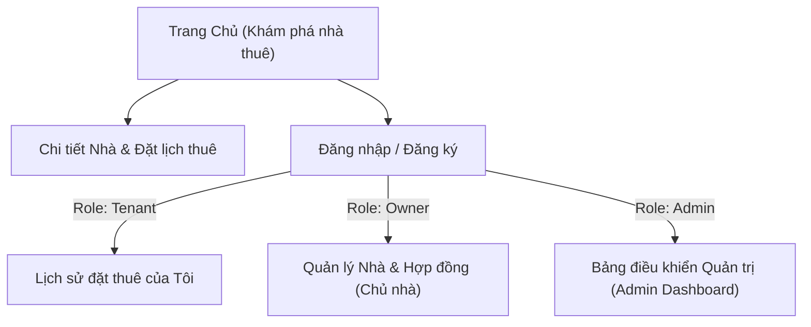

# HƯỚNG DẪN TỔNG QUAN BACKEND & LỘ TRÌNH PHÁT TRIỂN FRONTEND
> **Dự án**: Hệ Thống Quản Lý & Cho Thuê Nhà (House Rental Management System)  
> **Backend Framework**: ASP.NET Core Web API (.NET 10) | **Database**: Microsoft SQL Server  
> **Tài liệu tham chiếu**: Chuỗi 15 buổi học Lập trình Web API & Chuẩn hóa N-Tier Architecture  
> **Nhánh phát triển**: `XHuy`  

---

## PHẦN 1: TỔNG QUAN BACKEND ĐÃ HOÀN THIỆN

### 1. Kiến trúc Mã nguồn (N-Tier Architecture)
Dự án được tổ chức theo chuẩn kiến trúc nhiều tầng (N-Tier) nhằm phân tách trách nhiệm (Separation of Concerns), dễ bảo trì và mở rộng:

```
APIDemo/
├── Authorization/           # Buổi 9: Claims & Policy (MinimumAgeRequirement, MinimumAgeHandler)
├── Controllers/             # API Endpoints (Auth, Houses, Bookings, Contracts, Files, Users, Errors)
├── Data/                    # AppDbContext (EF Core) & DbInitializer (Seed Data tự động)
├── DTOs/                    # Data Transfer Objects (LoginDto, RegisterDto, HouseDto, BookingDto, ContractDto)
│   └── Common/              # PagedResult<T>, PageResult<T>, HouseQueryParameters, ErrorResponse
├── Exceptions/              # Custom Exceptions (AppException, NotFound, BadRequest, Unauthorized, Conflict)
├── Middleware/              # ExceptionHandlingMiddleware, RequestLoggingMiddleware, MiddlewareExtensions
├── Migrations/              # EF Core Code-First Migrations (20261124100139_InitialCleanRentalDb)
├── Models/                  # Entities (User, House, Booking, Contract, StoredFile, FileSettings)
├── Repositories/            # Data Access Layer - Tương tác EF Core (IHouseRepo, IBookingRepo, IAuthRepo...)
├── Services/                # Business Logic Layer (IHouseService, IBookingService, IAuthService...)
├── Properties/              # launchSettings.json (Cấu hình Port: https://localhost:7255; http://localhost:5066)
├── wwwroot/images/          # Buổi 10: Thư mục lưu trữ ảnh tĩnh phục vụ trực tiếp cho Frontend
├── appsettings.json         # Cấu hình Database, Serilog, JwtSettings, FileSettings
└── Program.cs               # DI Container, Pipeline Middlewares, CORS, StaticFiles, Serilog, Swagger UI
```

---

### 2. Thiết kế Cơ sở dữ liệu (`APIDemo`)
Cơ sở dữ liệu thống nhất mang tên **`APIDemo`** trên SQL Server (`localhost` hoặc `.`). Gồm 5 bảng chính được chuẩn hóa quan hệ toàn vẹn dữ liệu:



---

### 3. Cách chạy nhanh Dự án

#### Cách 1: Khởi tạo dữ liệu bằng SQL Server Management Studio (Khuyên dùng)
1. Mở file `Database_HouseRental.sql` tại thư mục gốc trong SSMS.
2. Bấm **F5 (Execute)** để chạy 1-click. CSDL `APIDemo` cùng 5 bảng, chỉ mục tối ưu và toàn bộ dữ liệu mẫu (mật khẩu `123456`) sẽ được tạo lập hoàn chỉnh.
3. Mở solution trong Visual Studio $\rightarrow$ Nhấn **F5** hoặc **Ctrl + F5**.

#### Cách 2: Khởi tạo dữ liệu qua EF Core CLI
1. Mở terminal hoặc Package Manager Console:
   ```powershell
   dotnet ef database update --project E:\APIDemo\APIDemo
   ```
2. Khởi chạy Web API:
   ```powershell
   dotnet run --project E:\APIDemo\APIDemo
   ```
3. Truy cập Swagger UI tại: **`https://localhost:7255/swagger`**.

---

### 4. Danh sách Toàn bộ API Endpoints

| STT | Nhóm | Method | Đường dẫn API | Quyền hạn (Authorization) | Mô tả tóm tắt |
| :---: | :--- | :---: | :--- | :--- | :--- |
| **1** | **Auth** | `POST` | `/api/auth/register` | Public (Ai cũng gọi được) | Đăng ký tài khoản mới (Username, Email, Pass, DOB...) |
| **2** | **Auth** | `POST` | `/api/auth/login` | Public | Đăng nhập hệ thống $\rightarrow$ Trả về JWT Token & thông tin User |
| **3** | **Auth** | `GET` | `/api/auth/me` | `[Authorize]` | Lấy thông tin user hiện tại từ Bearer Token |
| **4** | **Auth** | `GET` | `/api/auth/greeting` | `[Authorize]` | Lời chào cá nhân hóa kèm vai trò (Role) |
| **5** | **Auth** | `GET` | `/api/auth/secure-test` | `[Authorize]` | Kiểm tra tính hợp lệ của Token bảo vệ |
| **6** | **Houses** | `GET` | `/api/houses` | Public | Lấy danh sách nhà (Phân trang, Lọc giá/phòng, Tìm kiếm, Sắp xếp) |
| **7** | **Houses** | `GET` | `/api/houses/{id}` | Public | Xem chi tiết 1 căn nhà/phòng trọ |
| **8** | **Houses** | `POST` | `/api/houses` | `[Authorize(Roles = "Owner,Admin")]` | Đăng tin cho thuê nhà mới |
| **9** | **Houses** | `PUT` | `/api/houses/{id}` | `[Authorize(Roles = "Owner,Admin")]` | Cập nhật thông tin nhà cho thuê |
| **10** | **Houses** | `DELETE` | `/api/houses/{id}` | `[Authorize(Roles = "Admin")]` | Xóa bài đăng nhà cho thuê |
| **11** | **Bookings**| `GET` | `/api/bookings` | Public | Lấy danh sách lịch thuê/giữ chỗ phòng |
| **12** | **Bookings**| `GET` | `/api/bookings/{id}` | Public | Xem chi tiết 1 lịch thuê phòng |
| **13** | **Bookings**| `POST` | `/api/bookings` | `[Authorize(Policy = "AtLeast18")]` | Đặt thuê phòng (Chặn người dưới 18 tuổi - 403 Forbidden) |
| **14** | **Bookings**| `PUT` | `/api/bookings/{id}` | Public | Cập nhật thông tin/trạng thái lịch đặt phòng |
| **15** | **Bookings**| `DELETE`| `/api/bookings/{id}` | Public | Hủy/Xóa lịch đặt phòng |
| **16** | **Contracts**| `GET` | `/api/contracts` | `[Authorize(Roles = "Admin,Owner")]` | Xem toàn bộ danh sách hợp đồng thuê |
| **17** | **Contracts**| `GET` | `/api/contracts/{id}` | `[Authorize]` | Xem chi tiết hợp đồng thuê |
| **18** | **Contracts**| `GET` | `/api/contracts/booking/{bookingId}` | `[Authorize]` | Tra cứu hợp đồng theo mã BookingId |
| **19** | **Contracts**| `POST` | `/api/contracts` | `[Authorize(Roles = "Admin,Owner", Policy = "AtLeast18")]` | Tạo hợp đồng thuê nhà 1-1 gắn với Booking |
| **20** | **Contracts**| `PUT` | `/api/contracts/{id}` | `[Authorize(Roles = "Admin,Owner")]` | Cập nhật thông tin hợp đồng |
| **21** | **Contracts**| `DELETE`| `/api/contracts/{id}` | `[Authorize(Roles = "Admin")]` | Xóa hợp đồng |
| **22** | **Files** | `POST` | `/api/files/upload-image` | Public | Tải lên 1 ảnh nhà lưu vào `wwwroot/images` (Max 3MB, jpg/png) |
| **23** | **Files** | `POST` | `/api/files/upload-multiple` | Public | Tải lên nhiều ảnh nhà cùng lúc |
| **24** | **Files** | `POST` | `/api/files/upload-db` | Public | Tải lên file lưu vào DB bảng `StoredFiles` |
| **25** | **Files** | `GET` | `/api/files/download-db/{id}` | Public | Tải xuống file nhị phân từ DB theo ID |

---

### 5. Danh sách Tài khoản Kiểm thử Mẫu (Password: `123456`)

| Username | Role | Ngày sinh (DOB) | Tuổi | Ý nghĩa kịch bản kiểm thử |
| :--- | :---: | :---: | :---: | :--- |
| `admin` | **Admin** | `1990-01-01` | 36 tuổi | Quản trị viên cao nhất, có quyền xóa nhà, quản lý mọi hợp đồng |
| `owner_nam` | **Owner** | `1985-05-15` | 41 tuổi | Chủ nhà: đăng nhà, sửa nhà, lập hợp đồng thuê |
| `owner_hoa` | **Owner** | `1988-08-20` | 38 tuổi | Chủ nhà thứ 2 |
| `tenant_an` | **Tenant** | `2000-02-10` | 26 tuổi | Khách thuê đủ 18 tuổi $\rightarrow$ Gọi `POST /api/bookings` thành công (201 Created) |
| `tenant_tre_em`| **Tenant** | `2012-06-01` | 14 tuổi | Khách thuê chưa đủ 18 tuổi $\rightarrow$ Bị Policy `AtLeast18` chặn đứng (**403 Forbidden**) |

---

## PHẦN 2: LỘ TRÌNH & HƯỚNG DẪN KẾT NỐI CHO FRONTEND

### 1. Cấu hình Kết nối & Tương tác API

#### Base URL & Môi trường Local:
*   **HTTPS Base URL**: `https://localhost:7255`
*   **CORS**: Đã mở sẵn cho `http://localhost:3000` (React Create-React-App/Next), `http://localhost:5173` (Vite React/Vue), và các port tương ứng.

#### Cấu hình Axios Client chuẩn (kèm Interceptor tự động gắn Bearer Token):
```javascript
// src/api/axiosClient.js
import axios from 'axios';

const axiosClient = axios.create({
  baseURL: 'https://localhost:7255',
  headers: {
    'Content-Type': 'application/json',
  },
});

// Tự động đính kèm JWT token từ localStorage vào mọi request
axiosClient.interceptors.request.use(
  (config) => {
    const token = localStorage.getItem('token');
    if (token) {
      config.headers.Authorization = `Bearer ${token}`;
    }
    return config;
  },
  (error) => Promise.reject(error)
);

// Interceptor xử lý lỗi tập trung (bắt 401, 403, 500)
axiosClient.interceptors.response.use(
  (response) => response.data,
  (error) => {
    const response = error.response;
    if (response) {
      if (response.status === 401) {
        // Hết hạn phiên đăng nhập hoặc chưa đăng nhập
        localStorage.removeItem('token');
        localStorage.removeItem('user');
        window.location.href = '/login';
      }
    }
    return Promise.reject(error);
  }
);

export default axiosClient;
```

#### Hiển thị Ảnh tĩnh lưu tại `wwwroot/images`:
Khi API `POST /api/files/upload-image` thành công, nó trả về đường dẫn tương đối dạng:
```json
{
  "message": "Tải ảnh lên thành công.",
  "savedFileName": "0a00876c-b711-4c92-9a4a-e34d59cf50a6.png",
  "url": "/images/0a00876c-b711-4c92-9a4a-e34d59cf50a6.png"
}
```
Frontend chỉ cần ghép với Base URL để hiển thị:
```jsx
// React Component
const imageUrl = house.imageUrl.startsWith('http') 
  ? house.imageUrl 
  : `https://localhost:7255${house.imageUrl}`;


```

---

### 2. Danh sách Màn hình (Screens) Frontend Cần Xây Dựng



#### Màn hình 1: Trang chủ & Tìm kiếm nhà (`/` hoặc `/houses`)
*   **Chức năng**:
    *   Thanh tìm kiếm theo từ khóa (gọi query param `searchTerm`).
    *   Bộ lọc đa tiêu chí: Lọc theo khoảng giá (`minPrice`, `maxPrice`), số phòng ngủ (`bedrooms`), trạng thái (`status=Available`).
    *   Sắp xếp: Giá tăng/giảm dần (`sortBy=price&isDescending=true/false`), diện tích (`sortBy=area`).
    *   Phân trang (Pagination): Đọc `pageNumber`, `pageSize`, `totalCount`, `totalPages` từ response `PagedResult<House>`.

#### Màn hình 2: Chi tiết nhà thuê & Form Đặt phòng (`/houses/:id`)
*   **Chức năng**:
    *   Xem ảnh lớn, mô tả chi tiết, địa chỉ, giá thuê, diện tích, thông tin chủ nhà.
    *   Form chọn Ngày bắt đầu (`startDate`) và Ngày kết thúc (`endDate`).
    *   Bấm "Đặt thuê / Giữ chỗ" $\rightarrow$ Gửi `POST /api/bookings`. Nếu người dùng dưới 18 tuổi, bắt mã lỗi 403 để hiện thông báo: *"Bạn chưa đủ 18 tuổi để thực hiện ký kết/đặt thuê nhà!"*.

#### Màn hình 3: Đăng nhập & Đăng ký (`/login`, `/register`)
*   **Chức năng**:
    *   Form Đăng nhập: Username + Password $\rightarrow$ Lưu `token` và `user` vào `localStorage`.
    *   Form Đăng ký: Username, FullName, Email, Password, Phone, DateOfBirth, Role (`Tenant` hoặc `Owner`).

#### Màn hình 4: Quản lý Tin đăng & Hợp đồng cho Chủ nhà (`/owner/dashboard`)
*   **Chức năng**:
    *   Nút bấm "Đăng nhà mới" kèm Upload ảnh qua `/api/files/upload-image`.
    *   Bảng danh sách nhà của tôi $\rightarrow$ Sửa giá/trạng thái (`PUT /api/houses/:id`).
    *   Danh sách lịch đặt phòng cần duyệt $\rightarrow$ Tạo hợp đồng chính thức (`POST /api/contracts`).

#### Màn hình 5: Trang Quản trị Hệ thống (`/admin`)
*   **Chức năng**:
    *   Quản lý danh sách người dùng (`Users`).
    *   Toàn quyền xóa các tin nhà vi phạm (`DELETE /api/houses/:id`).
    *   Theo dõi tất cả hợp đồng thuê (`/api/contracts`).

---

### 3. Quy chuẩn Định dạng Dữ liệu (Format Specs)

#### Cấu trúc JSON khi Login / Register thành công (Status 200/201):
```json
{
  "message": "Đăng nhập thành công!",
  "token": "eyJhbGciOiJIUzI1NiIsInR5cCI6IkpXVCJ9...",
  "expiresAt": "2026-11-24T17:30:00Z",
  "user": {
    "id": 1,
    "username": "admin",
    "fullName": "Quản Trị Viên",
    "email": "admin@rental.com",
    "role": "Admin",
    "department": "IT",
    "dateOfBirth": "1990-01-01T00:00:00"
  }
}
```

#### Cấu trúc JSON phân trang danh sách nhà (Status 200):
```json
{
  "items": [
    {
      "id": 1,
      "title": "Căn hộ mini ban công thoáng mát",
      "description": "Đầy đủ nội thất gồm máy lạnh, tủ lạnh...",
      "address": "Quận 1, TP. Hồ Chí Minh",
      "price": 4500000.0,
      "area": 28.0,
      "bedrooms": 1,
      "imageUrl": "https://images.unsplash.com/photo-1522708323590-d24dbb6b0267",
      "status": "Available",
      "ownerId": 2
    }
  ],
  "totalCount": 4,
  "pageNumber": 1,
  "pageSize": 5,
  "totalPages": 1,
  "hasPreviousPage": false,
  "hasNextPage": false
}
```

#### Cấu trúc JSON Báo lỗi đồng nhất (ErrorResponse):
Tất cả các ngoại lệ xử lý tại Backend đều đi qua `ExceptionHandlingMiddleware` và trả về cấu trúc chuẩn:
```json
{
  "statusCode": 403,
  "message": "Bạn chưa đủ 18 tuổi để thực hiện nghiệp vụ này theo quy định hệ thống.",
  "traceId": "00-d0dad4d64e9b5602215763995da58fb7-bcb7db684c45bb91-00",
  "timestamp": "2026-11-24T15:30:12.456Z"
}
```

**Cách viết hàm xử lý Toast/Alert trong Frontend:**
```javascript
export const handleApiError = (error, showToast) => {
  if (error.response && error.response.data) {
    const { message, errors } = error.response.data;
    if (errors) {
      // Lỗi Validation từ ASP.NET Core
      const firstErrorKey = Object.keys(errors)[0];
      showToast(errors[firstErrorKey][0], 'error');
    } else if (message) {
      // Lỗi nghiệp vụ từ ErrorResponse
      showToast(message, 'error');
    } else {
      showToast('Đã xảy ra lỗi, vui lòng thử lại.', 'error');
    }
  } else {
    showToast('Không thể kết nối đến máy chủ Backend.', 'error');
  }
};
```
