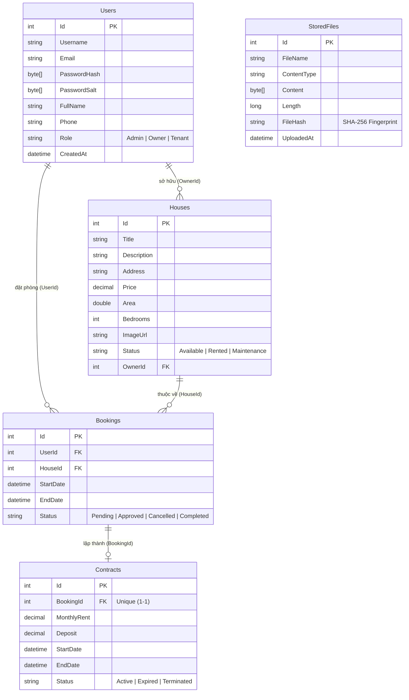

# BÁO CÁO ĐỒ ÁN VÀ HƯỚNG DẪN BẢO VỆ DỰ ÁN WEB API
**Môn học:** Lập trình .NET (ASP.NET Core Web API)  
**Đề tài:** Hệ thống Quản lý Cho thuê Nhà (House Rental Management System)  
**Công nghệ:** .NET 10, ASP.NET Core Web API, Entity Framework Core, SQL Server, JWT Bearer, Serilog, Swagger/OpenAPI.

---

## MỤC LỤC
1. [Phần 1: Mở Đầu](#phần-1-mở-đầu)
2. [Phần 2: Cơ Sở Lý Thuyết & Công Nghệ](#phần-2-cơ-sở-lý-thuyết--công-nghệ)
3. [Phần 3: Phân Tích & Thiết Kế Hệ Thống (Kèm ERD)](#phần-3-phân-tích--thiết-kế-hệ-thống)
4. [Phần 4: Triển Khai & Danh Sách Endpoints Chi Tiết](#phần-4-triển-khai--danh-sách-endpoints-chi-tiết)
5. [Phần 5: Tổng Kết & Cẩm Nang Bảo Vệ Đồ Án (Slide Buổi 15)](#phần-5-tổng-kết--cẩm-nang-bảo-vệ-đồ-án)
   - 5.1. Checklist nhanh trước khi lên bảng
   - 5.2. Danh sách tài khoản mẫu (Seed Data)
   - 5.3. Hướng dẫn sử dụng Postman Collection
   - 5.4. Bộ câu hỏi phản biện thường gặp của Giảng viên & Gợi ý trả lời

---

## PHẦN 1: MỞ ĐẦU
### 1.1. Đặt vấn đề
Thị trường cho thuê bất động sản (phòng trọ, căn hộ, nhà nguyên căn) ngày càng phát triển. Tuy nhiên, việc quản lý thủ công dễ dẫn đến sai sót trong quản lý lịch thuê, hợp đồng và hóa đơn.
Dự án **House Rental System API** cung cấp một giải pháp Backend RESTful Web API hoàn chỉnh, đáp ứng nhu cầu kết nối giữa **Khách thuê (Tenant)**, **Chủ nhà (Owner)** và **Quản trị viên (Admin)**.

### 1.2. Mục tiêu đề tài
- Xây dựng hệ thống Backend chuẩn RESTful API với kiến trúc đa tầng (N-Tier Architecture: Controller -> Service -> Repository -> Database).
- Đảm bảo an toàn bảo mật dữ liệu với xác thực và phân quyền dựa trên JSON Web Token (JWT) và Role-based Authorization.
- Tối ưu hóa hiệu năng truy vấn với Pagination, Filtering, Searching và Sorting.
- Kiểm soát ngoại lệ toàn cục (Global Exception Handling) và ghi vết nhật ký thời gian thực (Request Logging & Serilog).
- Cung cấp tài liệu API trực quan với Swagger/OpenAPI và hỗ trợ chia sẻ tài nguyên an toàn qua CORS.

---

## PHẦN 2: CƠ SỞ LÝ THUYẾT & CÔNG NGHỆ

| Công nghệ / Thư viện | Phiên bản | Vai trò trong hệ thống |
| :--- | :--- | :--- |
| **.NET SDK & ASP.NET Core** | `10.0` | Nền tảng xây dựng Web API hiệu năng cao |
| **Entity Framework Core** | `10.0` | ORM quản trị CSDL, ánh xạ quan hệ bảng và Code-First Migrations |
| **Microsoft SQL Server** | - | Hệ quản trị cơ sở dữ liệu quan hệ |
| **JWT Bearer Authentication** | `10.0` | Cơ chế xác thực không trạng thái (Stateless Authentication) |
| **Serilog & Sinks** | `9.0 / 6.0` | Ghi log có cấu trúc ra Console và File xoay vòng theo ngày (`Logs/log-.txt`) |
| **Swashbuckle Swagger UI** | `6.9` | Sinh tài liệu tương tác API và hỗ trợ test Authorization header |

### Các mẫu thiết kế (Design Patterns) áp dụng:
1. **Repository Pattern:** Tách biệt tầng truy cập dữ liệu (EF Core) khỏi tầng xử lý nghiệp vụ, giúp mã nguồn dễ kiểm thử, bảo trì và thay thế.
2. **Service Layer Pattern:** Đóng gói toàn bộ Business Logic và kiểm tra nghiệp vụ (Validation, Hash mật khẩu, kiểm tra ngày thuê).
3. **Dependency Injection (DI):** Đăng ký vòng đời `AddScoped` cho toàn bộ Repositories và Services, quản lý tài nguyên linh hoạt theo từng HTTP Request.
4. **Custom Middleware:** Can thiệp vào HTTP Request Pipeline để bắt lỗi tự động (`ExceptionHandlingMiddleware`) và ghi log đo thời gian thực thi (`RequestLoggingMiddleware`).

---

## PHẦN 3: PHÂN TÍCH & THIẾT KẾ HỆ THỐNG

### 3.1. Sơ đồ thực thể liên kết (Entity Relationship Diagram - ERD)



### 3.2. Mô hình kiến trúc nhiều tầng (N-Tier Architecture)

```
[ Client: Postman / Swagger / Frontend React/Vue ]
                     │ (HTTP Request qua CORS)
                     ▼
[ Middleware Pipeline: ExceptionHandling -> RequestLogging -> CORS -> Auth ]
                     │
                     ▼
[ Controllers ] : Tiếp nhận Request, Validate ModelState, gọi Service, trả HTTP Response chuẩn
                     │ (Truyền nhận DTOs)
                     ▼
[ Services ]    : Xử lý Business Logic, kiểm tra ràng buộc, mã hóa, xử lý ngoại lệ
                     │ (Truyền nhận Entities)
                     ▼
[ Repositories ]: Giao tiếp Entity Framework Core, thực hiện LINQ, AsNoTracking, phân trang
                     │
                     ▼
[ AppDbContext ]: Quản lý kết nối và ánh xạ bảng
                     │
                     ▼
[ Microsoft SQL Server Database ]
```

---

## PHẦN 4: TRIỂN KHAI & DANH SÁCH ENDPOINTS CHI TIẾT

### 4.1. Authentication & Users (`/api/users`)
| Method | Endpoint | Quyền hạn | Mô tả chức năng |
| :--- | :--- | :--- | :--- |
| `POST` | `/api/users/login` | Mọi người | Đăng nhập hệ thống, sinh chuỗi JWT Token |
| `POST` | `/api/users/register` | Mọi người | Đăng ký tài khoản mới (mặc định Role Tenant) |
| `GET` | `/api/users` | `Admin` | Lấy danh sách người dùng có phân trang (`PageNumber`, `PageSize`), lọc theo `Role`, tìm kiếm tương đối |
| `GET` | `/api/users/{id}` | Mọi người | Xem thông tin chi tiết một người dùng |
| `PUT` | `/api/users/{id}` | Mọi người | Cập nhật thông tin người dùng |
| `DELETE`| `/api/users/{id}` | `Admin` | Xóa người dùng khỏi hệ thống |

### 4.2. Houses (`/api/houses`)
| Method | Endpoint | Quyền hạn | Mô tả chức năng |
| :--- | :--- | :--- | :--- |
| `GET` | `/api/houses` | Mọi người | Danh sách nhà kèm **Pagination** (`PageNumber`, `PageSize` max 50), **Search** (`SearchTerm` tìm theo Title/Address), **Filter** (`Status`, `MinPrice`, `MaxPrice`, `Bedrooms`), **Sort** (`SortBy=price/area/title`, `IsDescending`) |
| `GET` | `/api/houses/{id}` | Mọi người | Xem chi tiết thông tin nhà cho thuê |
| `POST` | `/api/houses` | `Owner, Admin` | Đăng tin cho thuê nhà mới (nhận `HouseDto`) |
| `PUT` | `/api/houses/{id}` | `Owner, Admin` | Cập nhật thông tin nhà cho thuê (nhận `HouseDto`) |
| `DELETE`| `/api/houses/{id}` | `Admin` | Xóa nhà cho thuê |

### 4.3. Bookings (`/api/bookings`)
| Method | Endpoint | Quyền hạn | Mô tả chức năng |
| :--- | :--- | :--- | :--- |
| `GET` | `/api/bookings` | Mọi người | Xem danh sách đặt phòng (hỗ trợ lọc `status`) |
| `GET` | `/api/bookings/{id}` | Mọi người | Xem chi tiết 1 lịch đặt phòng |
| `POST` | `/api/bookings` | Mọi người | Tạo lịch đặt phòng mới (kiểm tra `StartDate < EndDate`, mặc định `Status = "Pending"`) |
| `PUT` | `/api/bookings/{id}` | Mọi người | Cập nhật lịch đặt phòng |
| `DELETE`| `/api/bookings/{id}` | Mọi người | Hủy / xóa lịch đặt phòng |

### 4.4. Contracts (`/api/contracts`)
| Method | Endpoint | Quyền hạn | Mô tả chức năng |
| :--- | :--- | :--- | :--- |
| `GET` | `/api/contracts` | `Admin, Owner` | Danh sách hợp đồng thuê nhà (hỗ trợ lọc `status`) |
| `GET` | `/api/contracts/{id}` | Có Token | Xem chi tiết hợp đồng |
| `GET` | `/api/contracts/booking/{bookingId}` | Có Token | Tra cứu hợp đồng theo mã lịch đặt phòng |
| `POST` | `/api/contracts` | `Admin, Owner` | Tạo hợp đồng thuê nhà mới (kiểm tra quan hệ 1-1 với Booking và giá thuê hợp lệ) |
| `PUT` | `/api/contracts/{id}` | `Admin, Owner` | Cập nhật hợp đồng thuê nhà |
| `DELETE`| `/api/contracts/{id}` | `Admin` | Xóa hợp đồng thuê nhà |

### 4.5. Files Storage (`/api/files`)
| Method | Endpoint | Quyền hạn | Mô tả chức năng |
| :--- | :--- | :--- | :--- |
| `POST` | `/api/files/upload` | Mọi người | Upload file nhị phân vào Database, kiểm tra chống trùng lặp bằng mã băm SHA-256 |
| `GET` | `/api/files/{id}` | Mọi người | Tải file về máy đúng tên file và `ContentType` gốc |

### 4.6. Exception Handling Tests (`/api/errors`)
| Method | Endpoint | Mục đích kiểm thử |
| :--- | :--- | :--- |
| `GET` | `/api/errors/bad-request` | Kiểm thử Middleware trả về mã `400 Bad Request` |
| `GET` | `/api/errors/unauthorized` | Kiểm thử Middleware trả về mã `401 Unauthorized` |
| `GET` | `/api/errors/not-found` | Kiểm thử Middleware trả về mã `404 Not Found` |
| `GET` | `/api/errors/server` | Kiểm thử Middleware bắt ngoại lệ chưa xử lý và trả về mã `500 Internal Server Error` có format chuẩn `ErrorResponse` |

---

## PHẦN 5: TỔNG KẾT & CẨM NANG BẢO VỆ ĐỒ ÁN

### 5.1. Checklist nhanh trước khi lên bảng bảo vệ (Trích Slide 15)
- [x] **Tránh Demo Effect:** Kiểm tra Connection String trong [appsettings.json](file:///E:/APIDemo/APIDemo/appsettings.json) khớp với SQL Server của máy tính. Chạy script [Database_HouseRental.sql](file:///E:/APIDemo/Database_HouseRental.sql) để có sẵn dữ liệu chuẩn.
- [x] **Khởi động chuyên nghiệp:** Không mở code Visual Studio lúng túng đầu tiên; chạy ngay Swagger (`https://localhost:7255/swagger`) hoặc Postman để trình bày như sản phẩm thực tế.
- [x] **Test phân quyền:** Chuẩn bị sẵn 2 luồng: Happy Path (Admin/Owner thực hiện thành công) và Luồng cấm quyền (Tenant gọi API của Admin -> nhận lỗi 403 Forbidden).
- [x] **Mở Log tự tin:** Nếu gặp lỗi đột xuất, bình tĩnh mở thư mục `Logs/` kiểm tra file nhật ký để phân tích nguyên nhân lỗi trực tiếp.

### 5.2. Danh sách tài khoản mẫu (Seed Data chuẩn để Demo)
> **Mẹo:** Ghi nhớ hoặc lưu ra Notepad màn hình desktop các tài khoản này trước khi bảo vệ:

| Tài khoản (Username) | Mật khẩu | Quyền (Role) | Chức vụ / Đại diện |
| :--- | :--- | :--- | :--- |
| `admin` | `123456` | **Admin** | Quản trị viên cao nhất hệ thống (xóa nhà, xem toàn bộ users, hợp đồng) |
| `owner_nam` | `123456` | **Owner** | Chủ nhà Nguyễn Văn Nam (đăng bài, sửa nhà, lập hợp đồng) |
| `owner_hoa` | `123456` | **Owner** | Chủ nhà Trần Thị Hoa |
| `tenant_an` | `123456` | **Tenant** | Khách thuê Lê Văn An (xem nhà, đặt lịch thuê) |
| `tenant_binh` | `123456` | **Tenant** | Khách thuê Phạm Thanh Bình |

### 5.3. Hướng dẫn sử dụng Postman Collection
1. Mở Postman -> Chọn **Import** -> Chọn file [HouseRental_Postman_Collection.json](file:///E:/APIDemo/HouseRental_Postman_Collection.json) trong thư mục gốc.
2. Chạy request `1. Authentication -> Login (Lấy JWT Token)` với tài khoản `admin`.
3. Script test tự động lưu token vào biến `{{token}}`. Tất cả các request sau có yêu cầu khóa bảo vệ (`Users`, `Houses`, `Contracts`) sẽ tự động có header `Authorization: Bearer <token>` mà không cần copy paste thủ công.

### 5.4. Bộ câu hỏi phản biện thường gặp của Giảng viên & Gợi ý trả lời

#### Câu 1: Em hãy giải thích cơ chế xác thực JWT và quy trình xác thực một Request?
- **Trả lời:**
  - Khi Client gửi thông tin đăng nhập đúng tại `/api/users/login`, Server băm lại mật khẩu kèm Salt lưu trong DB để so sánh. Nếu trùng khớp, Server ký một chuỗi JWT gồm 3 phần: Header (thuật toán mã hóa), Payload (chứa các Claim: `nameid`, `unique_name`, `role`), và Signature (chữ ký số tạo bởi SecretKey bí mật).
  - Ở các Request tiếp theo, Client đính kèm Header `Authorization: Bearer <token>`.
  - Middleware `Authentication` giải mã chữ ký bằng `SecretKey`. Nếu hợp lệ và còn hạn sử dụng, thông tin Claims được nạp vào đối tượng `HttpContext.User`.
  - Middleware `Authorization` kiểm tra xem Role trong `User` có khớp với `[Authorize(Roles = "...")]` của Controller/Action hay không để cho phép thực thi hoặc trả về `401 Unauthorized` / `403 Forbidden`.

#### Câu 2: Tại sao phải dùng Repository Pattern và Service Pattern mà không viết hết trong Controller?
- **Trả lời:**
  - **Tách biệt trách nhiệm (Separation of Concerns):** Controller chỉ làm nhiệm vụ tiếp nhận HTTP Request, validate dữ liệu đầu vào và trả về HTTP Response.
  - **Dễ bảo trì và kiểm thử:** Toàn bộ logic nghiệp vụ (kiểm tra ngày thuê, tính tiền cọc, tính toán phân trang) nằm ở Service. Toàn bộ thao tác truy vấn CSDL nằm ở Repository. Khi cần đổi ORM hoặc viết Unit Test với Mock Data, ta chỉ cần thay thế triển khai của Interface mà không làm xáo trộn Controller.
  - **Tránh hiện tượng Fat Controller:** Giữ cho Controller gọn gàng, trong sáng và tái sử dụng được Service ở nhiều nơi.

#### Câu 3: Em xử lý lỗi hệ thống tập trung như thế nào? Lợi ích so với try-catch ở từng hàm?
- **Trả lời:**
  - Hệ thống sử dụng `ExceptionHandlingMiddleware` đặt ở đầu HTTP Pipeline (`Program.cs`).
  - Mọi ngoại lệ chưa được bắt (Unhandled Exceptions) từ Controller hoặc Service văng ra đều được Middleware này hứng lại.
  - Middleware phân loại ngoại lệ thông qua `MapException`: ví dụ `AppException`/`BadRequestException` -> `400`, `NotFoundException` -> `404`, `UnauthorizedException` -> `401`, các lỗi không xác định -> `500`.
  - Lợi ích: Loại bỏ hoàn toàn khối `try-catch` lặp đi lặp lại ở từng hàm, đảm bảo mọi lỗi trả về cho Frontend luôn đồng nhất một cấu trúc JSON (`ErrorResponse`: StatusCode, Message, TraceId, Timestamp), và tự động ghi log cảnh báo bằng Serilog.

#### Câu 4: Phân trang (Pagination) ở tầng Repository hoạt động như thế nào? Tại sao phải dùng `AsNoTracking()`?
- **Trả lời:**
  - Ở `HouseRepository` và `UserRepository`, phân trang thực hiện bằng hai toán tử LINQ: `.Skip((PageNumber - 1) * PageSize)` và `.Take(PageSize)`.
  - Trước khi `Skip/Take`, hệ thống gọi `await query.CountAsync()` để lấy tổng số bản ghi thỏa điều kiện lọc nhằm tính `TotalPages`.
  - Sử dụng `.AsNoTracking()` vì đây là các truy vấn chỉ đọc (Read-only). `AsNoTracking()` báo cho Entity Framework Core không cần theo dõi sự thay đổi của đối tượng (Change Tracker), giúp tiết kiệm bộ nhớ RAM và tăng tốc độ truy vấn đáng kể.

#### Câu 5: CORS là gì? Cấu hình như thế nào trong ASP.NET Core?
- **Trả lời:**
  - CORS (Cross-Origin Resource Sharing) là cơ chế bảo mật của trình duyệt, ngăn chặn website từ một Origin (Scheme + Host + Port) khác gửi request độc hại đến API của Backend.
  - Trong dự án, CORS được đăng ký tại `Program.cs` bằng `builder.Services.AddCors()` cho phép các domain cụ thể của Frontend (ví dụ `http://localhost:3000`).
  - Middleware `app.UseCors("AllowFrontend")` bắt buộc phải đặt sau `UseRouting` và trước `UseAuthentication`/`UseAuthorization` để xử lý các Preflight Request (OPTIONS) trước khi thực hiện xác thực người dùng.

---
*Chúc các bạn tự tin, trình bày lưu loát và bảo vệ đồ án thành công đạt điểm tối đa!*
