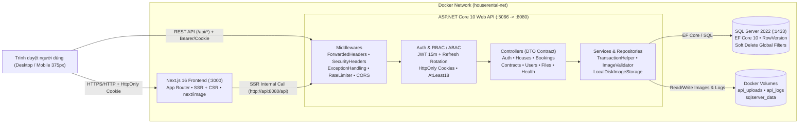
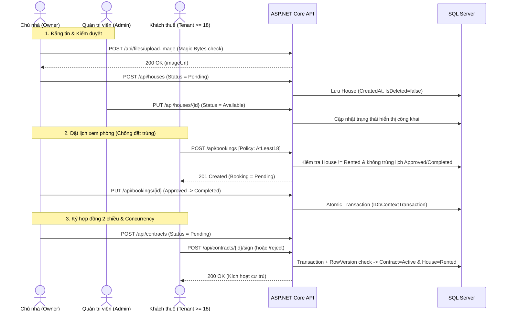

# House Rental Management System

[](https://dotnet.microsoft.com/)
[](https://learn.microsoft.com/aspnet/core/)
[](https://learn.microsoft.com/ef/core/)
[](https://www.microsoft.com/sql-server)
[](https://nextjs.org/)
[](https://react.dev/)
[](https://tailwindcss.com/)
[](https://docs.docker.com/compose/)
[](./APIDemo.Tests)
[](./.github/workflows/ci.yml)

Hệ thống **Sàn Giao Dịch & Quản Lý Cho Thuê Nhà (House Rental Management System)** xây dựng theo kiến trúc **Full-Stack Production-Ready** gồm:
- **Backend**: ASP.NET Core Web API (`.NET 10`), kiến trúc N-Tier (`Controller -> Service -> Repository -> EF Core / SQL Server 2022`), bảo mật JWT + Refresh Token Rotation + HttpOnly Cookies, Anti-IDOR, Rate Limiting, Optimistic Concurrency và Soft Delete.
- **Frontend**: Next.js `16` (App Router), React `19`, TypeScript, Tailwind CSS `v4`, đồng bộ bộ lọc tìm kiếm lên URL Query String kèm debounce, tối ưu ảnh `next/image`, SEO động `generateMetadata`, responsive chuẩn từ `375px`.
- **DevOps & Quality**: Đóng gói trọn bộ 3 container (`db`, `api`, `frontend`) qua Docker Compose, bộ Integration Tests (`xUnit + WebApplicationFactory`) và pipeline GitHub Actions CI.

---

## 1. Kiến trúc hệ thống



---

## 2. Luồng phân quyền & quy trình đặt thuê nhà khép kín



---

## 3. Tóm tắt các nhóm API chính

| Nhóm | Method & Endpoint | Phân quyền / Policy | Mô tả |
| :--- | :--- | :--- | :--- |
| **System** | `GET /health` | Public | Kiểm tra tình trạng ứng dụng & kết nối SQL Server (`DatabaseHealthCheck`) |
| **Auth** | `POST /api/auth/register` | Public | Đăng ký tài khoản (PBKDF2-HMAC-SHA512), trả Access + Refresh Token |
| | `POST /api/auth/login` | Public + `AuthLoginPolicy` | Đăng nhập (Rate Limit `5 req/phút/IP`), cấp JWT 15p + Refresh Token 7 ngày qua HttpOnly Cookie |
| | `POST /api/auth/refresh` | HttpOnly Cookie / Body | Xoay vòng Refresh Token (Token Rotation) & phát hiện tái sử dụng token bị đánh cắp |
| | `POST /api/auth/logout` | Authenticated / Cookie | Thu hồi Refresh Token trong DB & xóa HttpOnly Cookie |
| | `POST /api/auth/change-password` | `[Authorize]` | Đổi mật khẩu & tự động thu hồi toàn bộ phiên Refresh Token cũ |
| | `GET /api/auth/me` | `[Authorize]` | Lấy thông tin người dùng hiện tại từ JWT Claims |
| **Houses** | `GET /api/houses` | Public | Tìm kiếm, lọc (`searchTerm`, `minPrice`, `maxPrice`, `sortBy`), phân trang (`PageResult<HouseResponseDto>`) |
| | `GET /api/houses/{id}` | Public | Xem chi tiết nhà (ẩn các bản ghi đã Soft Delete) |
| | `POST / PUT / DELETE /api/houses` | `Owner, Manager, Admin` | Tạo, cập nhật (xóa ảnh cũ tự động), Soft Delete (chống IDOR chủ sở hữu) |
| **Bookings** | `GET /api/bookings` | `[Authorize]` | Xem lịch hẹn theo phạm vi vai trò (Admin: tất cả, Owner: nhà của mình, Tenant: lịch của mình) |
| | `POST /api/bookings` | `[Authorize(Policy="AtLeast18")]` | Tạo lịch xem/đặt thuê (chặn nhà `Rented` hoặc trùng khoảng ngày -> `409 Conflict`) |
| | `PUT / DELETE /api/bookings/{id}` | `[Authorize]` | Duyệt/hoàn thành/hủy lịch hẹn trong giao dịch nguyên tử, hỗ trợ Soft Delete |
| **Contracts** | `GET /api/contracts` | `[Authorize]` | Danh sách hợp đồng theo quyền sở hữu (`ContractResponseDto`) |
| | `POST / PUT /api/contracts` | `Admin, Owner, Manager` | Lập hợp đồng (`Pending`) / điều chỉnh hoặc chấm dứt hợp đồng (`Terminated` -> trả nhà `Available`) |
| | `POST /api/contracts/{id}/sign` | Tenant chủ booking | Khách thuê xác nhận ký -> `Contract=Active` & `House=Rented` (atomic + `RowVersion`) |
| | `POST /api/contracts/{id}/reject` | Tenant chủ booking | Khách thuê từ chối ký -> hủy hợp đồng chờ, giữ nhà `Available` |
| **Users** | `GET / DELETE /api/users` | `Admin` | Quản lý danh sách người dùng |
| | `PATCH /api/users/{id}/status` | `Admin` | Khóa / mở khóa tài khoản (`IsActive`) & thu hồi toàn bộ Refresh Token khi khóa |
| **Files** | `POST /api/files/upload-image` | `Admin, Owner, Manager` | Upload ảnh kiểm tra Magic Bytes (`JPG/PNG`), giới hạn dung lượng, trả URL công khai |
| | `GET /api/files/download/{id}` | `[Authorize]` + Anti-IDOR | Tải file riêng tư (chỉ chủ sở hữu `OwnerId` hoặc `Admin`) |

> Các endpoint thử nghiệm (`ErrorsController`, `EmployeesController`) được gắn `[DevelopmentOnly]` và tự động loại bỏ khỏi routing (trả `404`) khi chạy ngoài môi trường `Development`.

---

## 4. Hướng dẫn chạy dự án trong 3 bước

### Cách A: Chạy trọn bộ 3 dịch vụ bằng Docker Compose (Khuyên dùng)

**Yêu cầu**: Đã cài [Docker Desktop](https://www.docker.com/products/docker-desktop/).

```powershell
# Bước 1: Tạo file biến môi trường từ mẫu chuẩn
Copy-Item .env.example .env

# Bước 2: Build và khởi chạy trọn bộ SQL Server + ASP.NET Core API + Next.js Frontend
docker compose up --build

# Bước 3: Truy cập hệ thống
# - Frontend Web:  http://localhost:3000
# - Swagger API:   http://localhost:5066/swagger
# - Health Check:  http://localhost:5066/health
```

> Khi khởi chạy lần đầu, API sẽ chờ SQL Server đạt trạng thái `healthy`, tự động khởi tạo schema CSDL (`EnsureCreated`) và nạp dữ liệu mẫu (nhà cho thuê tại Đà Nẵng + tài khoản phân quyền). Dữ liệu được lưu bền vững trong Docker volumes (`sqlserver_data`, `api_uploads`, `api_logs`).

### Cách B: Chạy trực tiếp trên máy Local (Development)

**Yêu cầu**: [.NET 10 SDK](https://dotnet.microsoft.com/download/dotnet/10.0), [Node.js 22+](https://nodejs.org/), SQL Server / SQLEXPRESS (hoặc bật `UseInMemoryDatabase: true`).

```powershell
# Bước 1: Tạo file cấu hình bí mật local (không commit lên Git)
Copy-Item APIDemo\appsettings.local.example.json APIDemo\appsettings.local.json
# (Mở APIDemo/appsettings.local.json và cập nhật JwtSettings:SecretKey >= 32 ký tự & ConnectionStrings nếu cần)

# Bước 2: Khởi chạy Backend (.NET 10 API tại http://localhost:5066)
dotnet run --project APIDemo\APIDemo.csproj

# Bước 3: Mở terminal mới và khởi chạy Frontend (Next.js tại http://localhost:3000)
cd frontend
npm ci
npm run dev
```

### Tài khoản mẫu (Mật khẩu chung: `123456`)

| Vai trò | Username | Email | Quyền hạn chính |
| :--- | :--- | :--- | :--- |
| **Admin** | `admin` | `admin@rental.com` | Duyệt tin, quản lý & khóa tài khoản, giám sát toàn hệ thống |
| **Chủ nhà (Owner)** | `owner_nam` | `nam.owner@gmail.com` | Đăng tin, upload ảnh, duyệt lịch xem phòng, tạo & thanh lý hợp đồng |
| **Chủ nhà (Owner)** | `owner_hoa` | `hoa.owner@gmail.com` | Quản lý bất động sản & hợp đồng thuộc sở hữu |
| **Khách thuê (>= 18)** | `tenant_an` | `an.tenant@gmail.com` | Đặt lịch xem phòng (đạt Policy `AtLeast18`), ký/từ chối hợp đồng |
| **Khách thuê (< 18)** | `tenant_tre_em` | `nhi.underage@gmail.com` | Dùng kiểm thử chặn `403 Forbidden` với Custom Policy `AtLeast18` |

---

## 5. Các kỹ thuật nổi bật đã áp dụng

### Backend & Bảo mật (ASP.NET Core .NET 10)
- **Authentication chuẩn thực tế**: Access Token ngắn hạn (`15 phút`) kết hợp **Refresh Token Rotation** (`7 ngày`, lưu mã băm SHA-256 trong bảng `RefreshTokens`, cấp qua cookie `HttpOnly + SameSite + Secure`), phát hiện tấn công tái sử dụng token (Token Reuse Detection) và thu hồi toàn bộ phiên khi đăng xuất, đổi mật khẩu hoặc khóa tài khoản.
- **Mật khẩu & Phòng chống tấn công**: Băm mật khẩu bằng **PBKDF2-HMAC-SHA512** (salt ngẫu nhiên 64-byte), **Rate Limiting** (`5 lần/phút/IP` cho `/api/auth/login`) kèm `UseForwardedHeaders()` để lấy đúng IP sau Reverse Proxy, và `SecurityHeadersMiddleware` (`X-Content-Type-Options`, `X-Frame-Options`, `Referrer-Policy`, `CSP`).
- **Kiểm soát quyền & Chống IDOR**: Kết hợp RBAC (`Roles`) + ABAC (`MinimumAgeHandler` cho `AtLeast18`) và kiểm tra quyền sở hữu tài nguyên ở tầng Service cho `Houses`, `Bookings`, `Contracts` và `StoredFiles` (`OwnerId`).
- **Toàn vẹn dữ liệu & Concurrency**: Bọc các luồng thay đổi đa bảng (`Booking`/`Contract`/`House`) bằng `IDbContextTransaction` (`TransactionHelper`), chống tranh chấp ghi đồng thời bằng **Optimistic Concurrency** (`[Timestamp] byte[] RowVersion` -> `409 Conflict`), chống đặt trùng khoảng ngày, và **Soft Delete + Audit Timestamps** (`IAuditableSoftDelete` + EF Core Global Query Filters).
- **Upload ảnh an toàn**: Xác thực chữ ký file thực tế (**Magic Bytes** JPG/PNG), `[RequestSizeLimit]`, trừu tượng hóa lưu trữ qua `IImageStorageService` và tự động dọn ảnh cũ khi cập nhật/xóa nhà.

### Frontend (Next.js 16 + React 19 + Tailwind CSS v4)
- **Quản lý phiên thông minh**: Tự động lưu JWT vào duy nhất 1 storage (`localStorage` hoặc `sessionStorage`), đính kèm `credentials: "include"`, tự động **silent refresh** khi gặp `401` rồi retry request, và đăng xuất an toàn về `/login?reason=session_expired` nếu hết phiên.
- **Trạng thái Auth không lỗi Hydration**: Dùng `React.useSyncExternalStore` trong `useMockAuth` đảm bảo khớp tuyệt đối giữa SSR và Client Hydration.
- **Tìm kiếm & Bộ lọc chuẩn Web hiện đại**: Đồng bộ 2 chiều toàn bộ bộ lọc lên URL Query String kèm hook `useDebounce` (350ms), giữ nguyên bộ lọc khi F5 / chia sẻ link / Back-Forward.
- **Hiệu năng, SEO & Responsive**: 100% ảnh dùng `next/image` (AVIF/WebP + `sizes` + `priority`), SEO động `generateMetadata` + `React.cache` trên `/listings/[id]`, giao diện mobile `375px` đầy đủ drawer điều hướng cho cả 3 cổng Admin/Owner/Tenant.

### Kiểm thử & DevOps
- **xUnit Integration Tests** (`APIDemo.Tests`): 14 test case tự động dùng `WebApplicationFactory<Program>` phủ Auth/PBKDF2, Refresh Token Rotation & Logout, RBAC/IDOR Matrix, Double-Booking Guard, vòng đời Contract 2 chiều, Rate Limiting (`429`), Soft Delete và `/health`.
- **Docker Compose & GitHub Actions CI**: 1 lệnh `docker compose up --build` chạy đủ 3 container với `healthcheck`; CI tự động chạy `dotnet build`, `dotnet test`, `npm run lint`, `tsc --noEmit`, `npm run build` và `docker compose config` trên mọi Push/PR.

---

## 6. Cấu trúc thư mục dự án

```text
APIDemo/
├── .github/workflows/ci.yml       # GitHub Actions CI (Backend + Frontend + Docker validate)
├── docker-compose.yml             # Orchestration 3 dịch vụ: SQL Server + API + Next.js
├── .env.example                   # Mẫu biến môi trường chuẩn
├── APIDemo.slnx                   # Solution (.NET 10 API + xUnit Tests)
├── APIDemo/                       # Backend ASP.NET Core 10 Web API
│   ├── Authorization/             # Policy AtLeast18, MustBeHR
│   ├── Controllers/               # REST Controllers (DTO Contract)
│   ├── Data/                      # AppDbContext, TransactionHelper, DbInitializer
│   ├── DTOs/                      # Request/Response DTOs, Pagination, ErrorResponse
│   ├── Filters/                   # DevelopmentOnlyAttribute & Convention
│   ├── HealthChecks/              # DatabaseHealthCheck (/health)
│   ├── Middleware/                # ExceptionHandling, RequestLogging, SecurityHeaders
│   ├── Models/                    # Entities, RefreshToken, IAuditableSoftDelete
│   ├── Repositories/              # EF Core Data Access Layer
│   ├── Security/                  # PasswordHasher (PBKDF2), ImageFileValidator (Magic Bytes)
│   ├── Services/                  # Business Logic & IImageStorageService
│   └── Dockerfile                 # Multi-stage .NET 10 non-root container
├── APIDemo.Tests/                 # xUnit Integration Tests (14 test cases)
└── frontend/                      # Next.js 16 + React 19 + Tailwind CSS v4
    ├── src/app/                   # Public, Auth, Tenant (/account), Landlord (/dashboard), Admin (/admin)
    ├── src/components/            # UI primitives, Navbar, Sidebar, Gallery, SearchFilters
    ├── src/hooks/                 # useDebounce
    ├── src/lib/api/               # Centralized fetch client (Silent Refresh + 401 handler)
    └── Dockerfile                 # Multi-stage Node 22 Alpine standalone container
```
